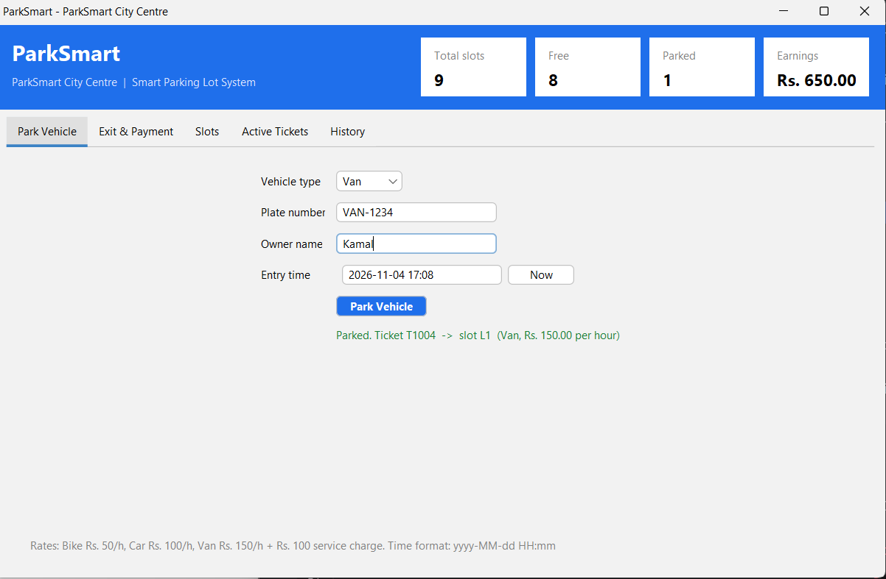
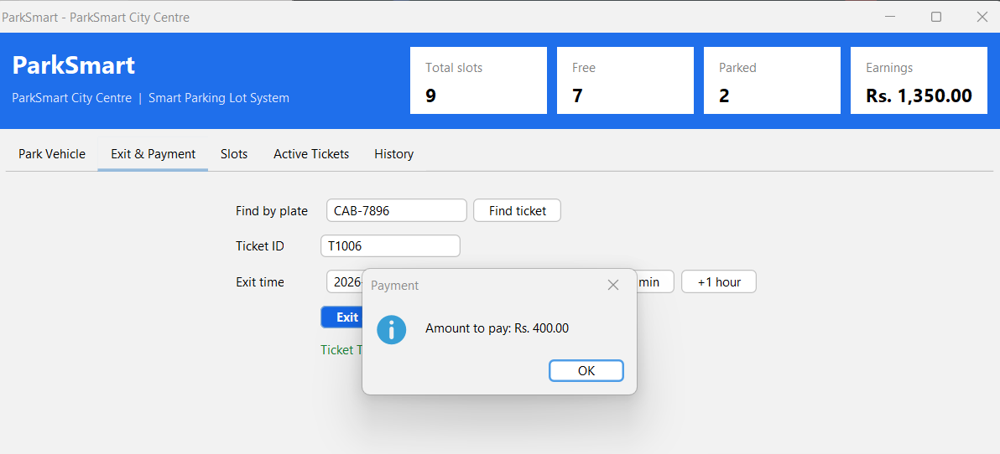
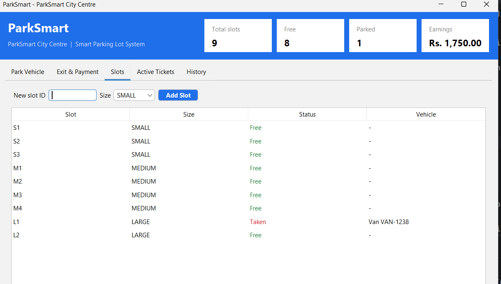
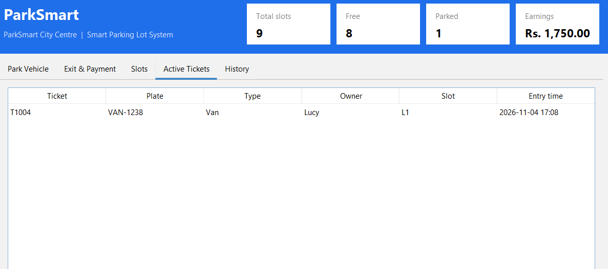
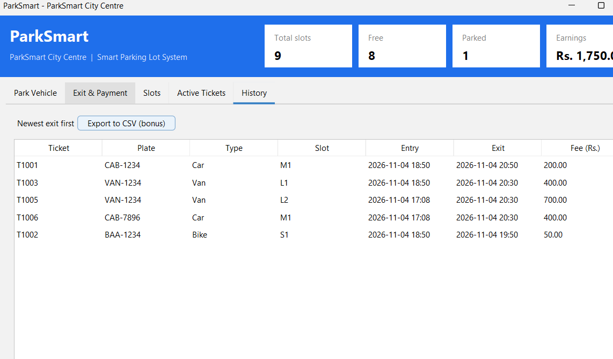

# ParkSmart – Smart Parking Lot System

> README TEMPLATE – replace every part in [square brackets] before you push to GitHub.

A Java desktop application that manages a car park: it parks vehicles in the right slot, issues tickets, calculates parking fees and keeps a payment history.

Built by Divanshika & Divanshana as an Object-Oriented Programming project.

## Screenshots

## Features

- Park cars, bikes and vans.
- Automatically assign the smallest suitable available parking slot.
- Generate unique parking tickets.
- Find active tickets using vehicle plate numbers.
- Calculate parking fees based on vehicle type and parking duration.
- Apply the additional service charge for vans.
- Round parking duration up to the next full hour.
- Display parking slot availability.
- Maintain active and completed parking tickets.
- Display payment history with the newest transactions first.
- Calculate total parking earnings.
- Handle invalid operations using custom exceptions.

## OOP design

| Principle | Where I used it |
| --- | --- |
| Encapsulation | Private attributes are used in Vehicle, ParkingSlot, Ticket and ParkingLot. Public getter methods provide controlled access|
| Inheritance | Car, Bike and Van inherit common attributes and methods from the Vehicle parent class |
| Abstraction | Vehicle is an abstract class that defines common vehicle behaviour and abstract methods |
| Polymorphism | Car, Bike and Van override methods to provide their own vehicle details, parking rates and fee calculations|

[Add your UML class diagram image here.]

## Tech stack

Java 17 · Swing (FlatLaf theme) · Maven · JUnit 5 · Git and GitHub

## How to run

1. Clone this repository.
2. Open the folder in IntelliJ IDEA (it loads as a Maven project).
3. Run `src/main/java/com/parksmart/ui/Main.java`.

## Tests

Run all tests with **right-click `src/test/java` → Run 'All Tests'**, or `mvn test`.

[Write how many tests you have and one line on what your own 3 tests check.]The project includes 20 provided JUnit tests and 3 additional tests written in MyOwnTests.java.

The additional tests check:
- Rejection of an empty vehicle owner name.
- Rejection of a null vehicle.
- Rejection of a null vehicle entry time.
## What I learned

Through this project, I learned how to apply object-oriented programming concepts in a Java application. I practised using inheritance, encapsulation, abstraction and polymorphism while developing a parking management system. I also learned how to handle exceptions, use Java collections 
and test application functionality using JUnit 5.
